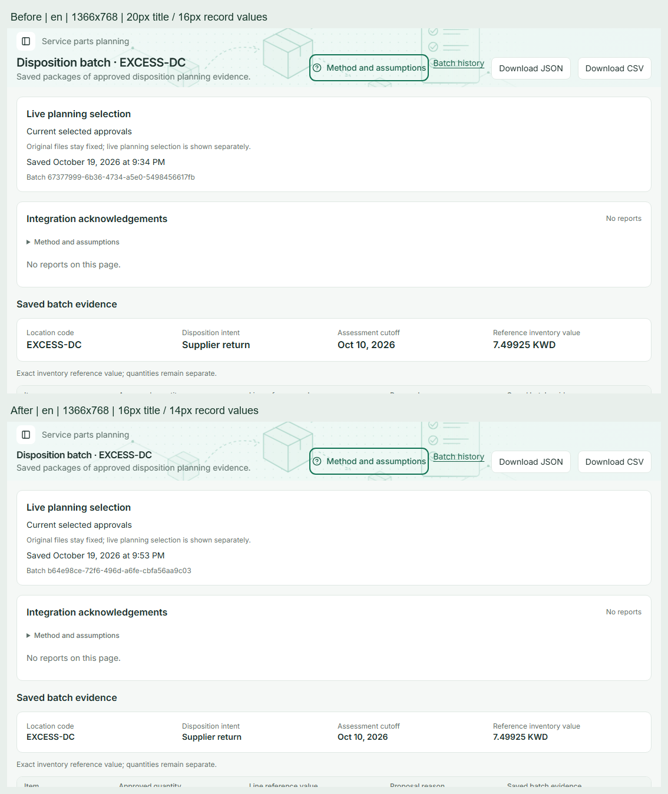
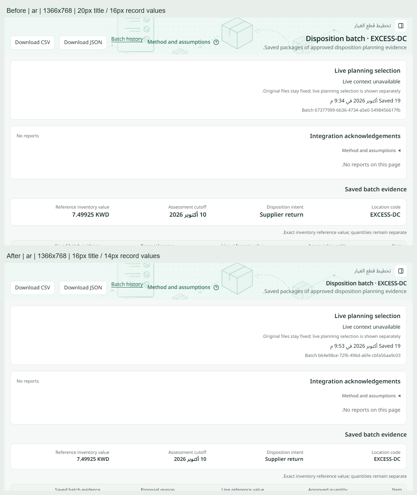
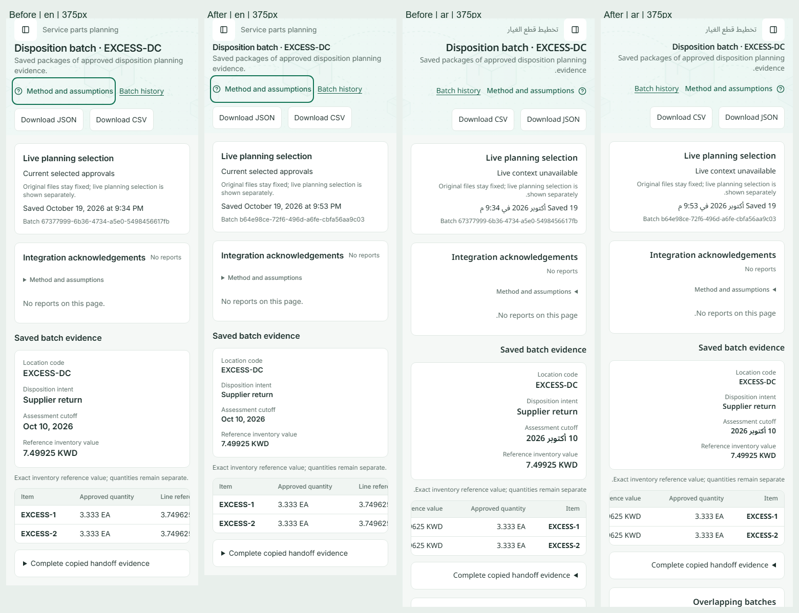

# Compact shared typography

The owner approved 16px/24px page titles and 14px/20px compact record values on 2026-10-19 after highlighting the disposition-batch title and location code. This revision replaces the earlier sizes recorded in historical screenshot reports. The implementation is based on merged main `d9a80c9`.

## Shared standard

| Role                          | Before      | Approved size | Weight        |
| ----------------------------- | ----------- | ------------- | ------------- |
| Page title                    | 20px / 28px | 16px / 24px   | 600           |
| Compact planning/record value | 16px / 24px | 14px / 20px   | 600           |
| Body, sidebar and actions     | 14px / 20px | 14px / 20px   | Existing role |
| Section title                 | 16px / 24px | 16px / 24px   | 600           |
| Caption and table heading     | 12px / 16px | 12px / 16px   | Existing role |

`globals.css` defines the two shared roles in rem. PageHeader, Dashboard, Forecasts, detail/create/edit screens and planning reports inherit them. Loading-title placeholders use the same title line-height variable instead of retaining a fixed 28px height. The body/sidebar scale, 16px mobile inputs, 44px mobile targets and documented Dashboard/login/help-panel exceptions are preserved. No business calculations, formatting, queries, API contracts or schema definitions change.

The current `design.MD` and regression ledger are the authoritative rules. Use `text-page-title` and `text-evidence-value`; do not introduce page-specific larger sizes or copy old measurements from historical reports.

## Actual visual comparison

The following images come from local production builds before and after the change, with synthetic fixture data and normal browser zoom. Both builds include the current disposition acknowledgement/integration features. Fixture identifiers and timestamps differ between runs.

The batch workflow checks the title and every location, disposition, cutoff-date and reference-value field at 375, 768, 1024, 1366, 1440 and 1920px, including Arabic RTL. It records actual computed sizes, line heights, weights and families. Broader matrices cover 1280×800, 1366×768, 1440×900, 375×900 and 390×844, Dashboard ↔ Items navigation, long identifiers, empty/partial data, errors, permissions and existing loading boundaries. Text wraps or tables scroll locally; the page is not clipped to conceal overflow.

The retained font summary contains 623 computed-style observations across 70 captures: 70 page titles, 227 record values, 30 subtitles, 216 sidebar labels, 65 method captions and 15 buttons. All match their documented roles and locale font families. A separate action matrix checks 80 links; 35 section-header observations retain a maximum 12px tagline-to-title gap. No measured typography or action-size violations were found.

These are Chromium CSS viewport checks, not physical-laptop or iOS Safari testing. Arabic planning text may retain the documented English fallback; translation completeness is outside this typography revision. Representative screenshots were inspected directly, rather than treating generated image counts as manual review coverage.

## Verification

- Before captures: Dashboard, section headers and disposition batches passed their existing workflows. The expanded RTL capture was corrected to inspect the visible banner rather than retained hidden markup.
- New compact contract against the old production build: failed as expected, receiving a 20px title instead of 16px.
- Web unit suite: 140 files / 1,630 tests passed; final header/loading contract guards also passed separately (3 tests).
- Production build, strict types, lint and logical-utility checks: passed.
- Isolated UI/keyboard/help fixtures: 16 passed. Their background-page heading assertion now shares the approved title contract; help-panel type remains unchanged.
- Full application browser run: 115 cases discovered, 109 passed, 3 optional scale cases skipped and 3 failed on the first run. All typography/layout cases passed. The failures were an 8-second demand-write API timeout, a scale-fixture cleanup timeout and an acknowledgement screenshot selector matching hidden prior markup.
- Clean-stack rechecks: all 3 passed, including API atomicity/tenancy, copied acknowledgement history and 50,000-item navigation plus cleanup. The four measured catalog navigations took 474–765ms. Thus all 112 enabled cases passed across the initial run and targeted rechecks; the entire suite was not rerun a second time. No application timeout, API contract or performance assertion was relaxed. Reset applied all current migrations and seed data; Storage initially exceeded its restart readiness deadline, then became healthy before the rechecks began. This was the isolated synthetic stack on ports 55321/55322, with no hosted or primary-project database changes.
- Font summary and ECC rendered-evidence record: passed, alongside direct inspection of laptop, desktop, mobile, Arabic RTL, Dashboard/Items, transfer detail, loading and error captures. Repository formatting, final generated-evidence formatting, added-line secret/debug pattern scan and diff review passed. Coverage instrumentation is not configured or collected for this CSS change.

`e2e/helpers/typography.ts` holds independent expected roles for browser assertions. It does not read the CSS variables, so an incorrect token cannot make its own check pass. The full workflows retain their data, tenancy, authorization, immutable-download and HTTP 404 assertions. Screenshot selectors target the visible page when the framework retains hidden prior pages.

Measured results and rendered evidence are retained in [the font summary](compact-shared-typography-visuals/typography-summary.json) and [the evidence record](compact-shared-typography-visuals/evidence.json). No merge or deployment is included.
