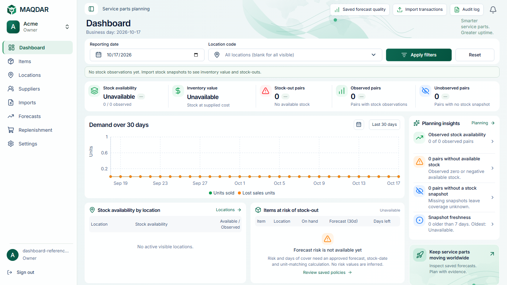

# Compact laptop dashboard

The owner reported oversized icons/type and a broken “Unavailable” label on a 13-inch laptop. The prior typography-only change did not compact the entire dashboard. This follow-up uses available CSS viewport width: **1100–1536px** receives a compact desktop layout, covering common 1280, 1366, 1440 and 1536px laptop viewports.

| Element            | Compact laptop treatment                                                            |
| ------------------ | ----------------------------------------------------------------------------------- |
| Sidebar            | 208px wide; 13px navigation text, 18px icons, 36px rows                             |
| Header / title     | 48px header; 24px title; 12px subtitle                                              |
| Filters            | 34px controls with 12px input text                                                  |
| KPI strip          | Five columns; 32px icon tiles with 21px glyphs; 20px numeric values                 |
| Unavailable values | 16px status text with normal word wrapping, distinct from numeric metrics           |
| Panels             | 12px gaps; 13px panel headings; 16px chart heading                                  |
| Demand chart       | 222px panel instead of 280px                                                        |
| Lower tables       | Side by side throughout the laptop range; compact rows and wrapping column headings |
| Insights           | 32px icon tiles, 12px text and reduced row spacing                                  |

The large 1648/1672px composition stays unchanged. Tablet/mobile reflow and 44px mobile controls remain intact. Warnings, localized text and unknown data are not hidden or truncated to force a fit. No business data, calculations, authorization or backend contracts change.

Verification uses the authenticated production app and isolated local Supabase. The existing reference test now checks both empty and populated states at four laptop sizes, including one-line English “Unavailable” labels, five KPI columns, no horizontal page overflow, and lower panels within the populated viewport. Existing mobile/RTL, currency, tooltip, large reference and cross-page checks remain in place.

At **1366 × 768**, the populated KPI strip measures **81px** high and the chart **222px**. Both lower panels finish at **y733.7**, within the viewport. The empty-state warning remains visible and “Unavailable” stays on a single line. [Measured bounds](dashboard-laptop-visuals/dashboard-laptop-bounds-1366.json) accompany the captures.

[Populated 1366px](dashboard-laptop-visuals/dashboard-laptop-populated-1366.png), [1280px](dashboard-laptop-visuals/dashboard-laptop-populated-1280.png), [1440px](dashboard-laptop-visuals/dashboard-laptop-populated-1440.png), [1536px](dashboard-laptop-visuals/dashboard-laptop-populated-1536.png), and [Arabic 1366px](dashboard-laptop-visuals/dashboard-laptop-arabic-1366.png). Empty-state captures at all four widths are in the same directory. No production mock data or CSS zoom is used.

Local validation: lint, strict typing, logical CSS, formatting, all 1244 unit tests, production build and all six reference/responsive browser tests. The first responsive run identified its old 14px desktop filter assertion; only the laptop-dashboard expectation changed to the approved 12px, with all other routes and mobile input expectations retained. Full CI results are available on the follow-up PR.
