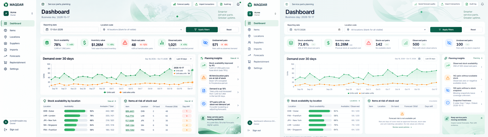

# Dashboard reference — Track A implementation and verification

The owner approved Track A on 2026-10-17. Work started at `747d39d` (PR #39) in an isolated managed worktree and was rebased onto `c3171b9` (PR #40), then `3b4cfde` (PR #41), as they merged. The original checkout and its unrelated transfer-date/freight edits were not changed, stashed, reset or committed. The dashboard diff adds no database migrations, generated database types, planning calculations or Track B functionality.

The [approved plan and functional gap assessment](dashboard-reference-plan.md) contains the requested feature matrix, data/calculation/backend distinctions, business decisions, tenancy considerations, complexity estimates and recommended development order. Those recommendations remain out of scope.

## Implemented behavior

- Dashboard-scoped sidebar, header, hero, filters, five-cell KPI strip, chart, two lower tables, insights and information panel. Other application pages retain their existing styling; mobile navigation and organization switching use their existing components.
- Existing server-rendered `dashboard_kpis` contract for summary and demand. Active visible locations are read with an explicit organization filter and existing RLS; suggestions stop at 50, the preview at five in code order, and a selected location reuses the main result. Optional read failures remain unavailable, never zero.
- Availability continues to use positive **observed** stock pairs divided by observed pairs. Missing coverage remains unknown, stale snapshots remain included and visibly flagged, and inventory value remains physical stock at supplied snapshot cost. Currency totals are never combined or converted. The compact amount opens all exact three-decimal totals and a currency selector.
- Recharts area/line chart, pointer tooltip with exact decimal strings, chronological left-to-right plotting in either locale, and an expandable exact daily-data table. Date/location filters retain existing validation and URL semantics.
- Location-row navigation retains the reporting day. Both forecast-quality links carry the selected location and omit the unsupported dashboard date filter.
- Four insights restate actual current facts. Trend chips, forecast risk/days of cover and notifications explicitly remain unavailable. No production fixture, synthetic metric, inferred risk score or unread notification indicator was added.
- English/Arabic copy, logical CSS, responsive layouts, keyboard-accessible table regions, route skeleton/error/retry UI and per-location failure handling. Access-controlled import/audit actions retain their existing role checks.

## Reference measurements

The supplied file is 1672 × 941, rather than the approximate 1648 × 928 in the request. Both viewports are captured at device scale 1 using the actual authenticated application, a production Next.js build and local Supabase data. Fixtures exist only in Playwright; `/dashboard?day=2026-10-17` is the production route.

| Region                       | Reference target at 1672 × 941 | Implemented layout                 |
| ---------------------------- | ------------------------------ | ---------------------------------- |
| Sidebar                      | 248px                          | 248px                              |
| Main start / end inset       | x275 / 21px                    | x275 / 21px                        |
| Filter                       | y149, height 88px              | y149, minimum 88px                 |
| Unified KPIs                 | y249, height 107px             | y249, 107px asserted in Playwright |
| Main chart                   | y372, 1066 × 280px             | y372, 1066 × 280px                 |
| Right column                 | x1357, 294px wide              | x1357, 294px wide                  |
| Lower tables                 | y668, 251px high               | y668, minimum 251px                |
| Main gaps                    | 16px                           | 16px                               |
| Insight / information panels | 398px / 139px                  | minimum 398px / 139px              |

Text or warnings can legitimately increase minimum heights. We do not clip stale warnings, long localized text or missing coverage to force a screenshot match.

## Comparison methodology and limitations

The comparison script uses Pillow and NumPy from the desktop's bundled runtime; no application dependency was added. `dashboard-visuals/compare.py` computes luminance SSIM with an 11 × 11 Gaussian window, sigma 1.5, population covariance, K1 0.01, K2 0.03 and a 255 range. It excludes only the five-pixel convolution border. It applies no content masks, image registration or implementation rescaling. RGB mean absolute error is reported separately and is not a perceptual percentage.

Early full-page screenshots are cropped to the original viewport. The native reference is unchanged for the 1672px comparison; for the secondary 1648 × 928 comparison only the reference is resampled with Lanczos. The secondary score therefore includes a small scale mismatch relative to fixed CSS dimensions. Overlays blend at 50%; difference images amplify absolute RGB differences fourfold. Side-by-side images show reference left, actual application right.

Three correction passes adjusted geometry, KPI/icon density, chart dimensions/grid/axes, card spacing and typography. The final production capture follows these passes. Screenshots, reproducible measurements and comparison images are in [dashboard-visuals](dashboard-visuals/).

**The 95% perceptual target has not been demonstrated. This implementation is not claimed to be pixel-perfect.** Full-frame SSIM is sensitive to text position and content, and the unavailable risk table differs substantially from the sample's illustrative rows. The numerical results are reported without masking those differences.

| Capture                                                | Unmasked luminance SSIM | RGB mean absolute error (0–255) |
| ------------------------------------------------------ | ----------------------- | ------------------------------- |
| Original dashboard, native viewport                    | 0.681914                | 16.3757                         |
| First layout iteration                                 | 0.701998                | 13.6527                         |
| Second correction                                      | 0.702127                | 13.3574                         |
| Third correction                                       | 0.756813                | 10.7709                         |
| Final production, 1672 × 941                           | 0.769123                | 10.2552                         |
| Final production, 1648 × 928 against resized reference | 0.698528                | 13.1369                         |

Native [50% overlay](dashboard-visuals/overlay-1672.png), [amplified difference](dashboard-visuals/difference-1672.png), [tooltip](dashboard-visuals/dashboard-tooltip-1672.png), [mobile](dashboard-visuals/dashboard-mobile-375.png), [Arabic desktop](dashboard-visuals/dashboard-arabic-1672.png), and [Arabic mobile](dashboard-visuals/dashboard-arabic-375.png) are provided alongside the [secondary-size comparison](dashboard-visuals/comparison-1648.png). [Environment and measured bounds](dashboard-visuals/dashboard-environment.json) record Chromium 156.0.8078.4, device scale 1 and the actual font stack. The final insight content needs 401px rather than 398px, moving the information panel down 3px; the other main panel bounds are within subpixel rounding of the table above.

Remaining differences:

- Actual inventory counts, dates, currency labels and account identity differ from sample content. Neutral unavailable trend indicators replace unsupported percentages. Risk rows are an honest unavailable state; insight text states current observations instead of unimplemented comparisons.
- The reference's globe/wave source artwork and exact font were not provided. The implementation uses existing Inter and authored decorative SVG approximations of the supplied motifs.
- Native date-input presentation follows browser locale. There is no unsupported date-range dropdown or active notification dot.
- Locations are a bounded code-ordered preview and use observed denominators. The sample's order and “total” semantics are not copied. Accessible definitions and daily data remain available below the main composition.
- Text wrapping, glyph rendering, icon paths and subtle antialiasing differ. Responsive layouts intentionally rearrange below the reference width; Arabic mirrors layout while preserving chronological chart direction.

## Verification record

Required local checks run against a separate `MAQDAR-dashboard-reference` stack on ports 55321–55324, with the app on 3100. Database suites run sequentially. No hosted service is used.

| Check                                                | Result                                                               |
| ---------------------------------------------------- | -------------------------------------------------------------------- |
| `pnpm lint`, `pnpm typecheck`, `pnpm check:logical`  | Passed on the rebased branch                                         |
| `pnpm format:check`                                  | Passed                                                               |
| Complete web unit suite, `vitest run --maxWorkers=2` | 99 files, 1232 tests passed on PR #41 plus dashboard                 |
| Full pgTAP on PR #40 plus dashboard                  | 50 files, 2885 assertions passed                                     |
| Engine `uv run pytest -q`                            | 293 passed; 113 database tests skipped and run separately            |
| Engine `uv run pytest -m db -q`                      | All 113 passed before rebase                                         |
| New main-branch `test_transfer_dates_db.py`          | All 6 passed after rebase; engine implementation otherwise unchanged |
| `node --test scripts/import-retention.test.mjs`      | All 3 passed                                                         |
| `pnpm --filter web build`                            | Production build passed                                              |

The complete production browser run finished with **59 passed, two optional import-scale tests skipped, and one performance threshold miss** (2088ms versus 2000ms while image comparisons were running). The isolated repeat passed the unchanged threshold: **1327ms, 1033ms, 1012ms**, and **821ms** for location-filtered navigation, with 50,000 items, 40 locations, 50,000 snapshots and 50,000 demand rows. These are local measurements, not a production SLA.

The final focused reference and planning-KPI tests both passed after fixing Arabic mobile currency overflow and waiting for visible server-streamed content and settled fonts. Coverage includes both desktop viewports, 375px English/Arabic, tooltip values, location drill-down, scoped forecast-quality navigation/reset, and separate USD/KWD selection with exact totals. Existing responsive checks passed at 375, 768, 1024, 1440 and 1920px across the application.

A controlled local failure drill held a stock-table lock for two seconds, then separately revoked and restored the authenticated KPI function permission on the isolated test stack. [Loading](dashboard-visuals/dashboard-loading-1672.png), [safe error](dashboard-visuals/dashboard-error-1672.png) and visible one-click recovery all passed. The drill caught and fixed a real retry defect: retry now refreshes server data and resets the boundary within a transition. Permission restoration was verified through successful recovery and enforced in the drill's `finally` block. No production permission changed.

Generated public database types matched the committed contract without modifying the shared file. The PR CI is configured to repeat the complete suites against the final merged base, including Linux Cloudflare packaging. CI results are available on the PR; this document records local results and does not predeclare CI success. No deployment command is run.

The initial unconstrained unit run hit a five-second filesystem-scan timeout in the existing API isolation test during heavy concurrent work. Re-running the complete suite with two workers passed all 95 files / 1211 tests; the subsequent optional-read rejection regression passed separately. No assertion or timeout was weakened.

Manual review applied the verified ECC coding-standards, React-patterns, e2e-testing and security-review skills. The review checked exact monetary strings, bounded query fan-out, explicit tenant predicates, preservation of invoker RLS and authorization, safe error copy, client namespace serialization, logical layout, scoped CSS and absence of backend changes. This is a manual review, not a claim that an automated code-review service ran.
