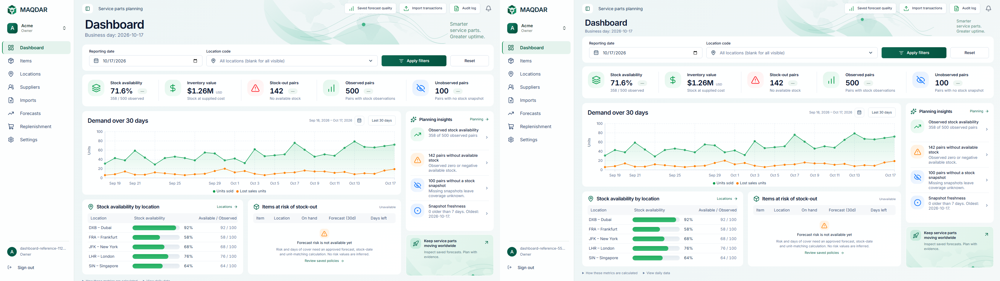

# Compact dashboard typography

The owner requested smaller dashboard heading/subheading text and better vertical space utilization after PR #42 merged. This intentionally supersedes the original screenshot's oversized title area; the earlier reference report remains a historical record.

| Element               | Before                  | After       |
| --------------------- | ----------------------- | ----------- |
| Desktop title         | 40px / 48px line height | 28px / 36px |
| Mobile title          | 32px / 42px line height | 24px / 32px |
| Business-day subtitle | 16px / 23px             | 13px / 20px |
| Supporting tagline    | 16px / 21px             | 13px / 17px |
| Desktop title region  | 91px                    | 64px        |
| Mobile title region   | 85px                    | 60px        |

The title keeps its semibold weight, with proportionate letter spacing. Reduced bottom padding and tagline spacing reclaim 27px on desktop and 25px on mobile. The filters, KPI strip, chart and lower panels move upward together; their sizes and data behavior remain unchanged. The decorative artwork scales with the shorter title area. Loading/error headings share the same styles.

Actual production measurements at 1672 × 941 put the filters at y122 (previously y149), KPIs at y222.14 (previously y249.14), and chart at y345.14 (previously y372.14). The KPI strip remains 107px high and the chart remains 1066 × 280px. The complete lower panels and daily-data disclosures now fit within the viewport. These are measured application screenshots, not a generated mockup.

[Native desktop](dashboard-typography-visuals/dashboard-typography-1672.png), [1648px desktop](dashboard-typography-visuals/dashboard-typography-1648.png), [mobile](dashboard-typography-visuals/dashboard-mobile-375.png), [Arabic mobile](dashboard-typography-visuals/dashboard-arabic-375.png), and [measured bounds](dashboard-typography-visuals/dashboard-environment.json).

Existing responsive and reference tests retain their overflow, keyboard, RTL, currency and 107px KPI-strip assertions; only the requested typography and vertical position expectations change. Local verification includes lint, strict typing, logical CSS, formatting, all 1244 unit tests, a production build and the six reference/responsive browser tests across 375, 768, 1024, 1440 and 1920px. Full CI results are recorded on the follow-up PR. No business logic, authorization or database contracts change.
