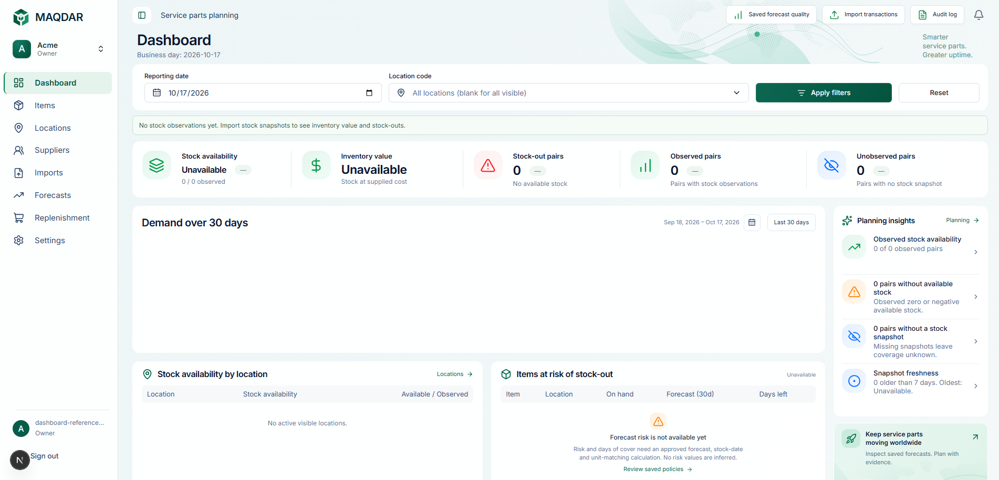
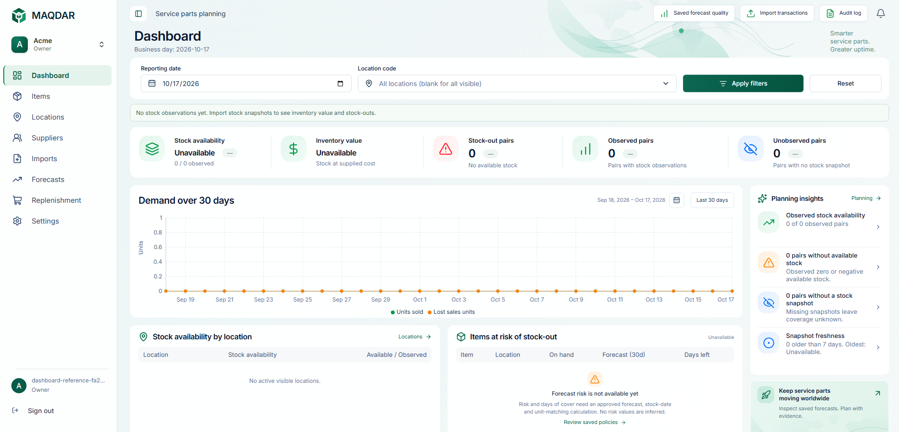

# Consistent unavailable KPI typography

The reported desktop screenshot showed inventory “Unavailable” larger than the adjacent stock-availability status. The inventory amount selector appeared later in the stylesheet with the same specificity, overriding the status font size. Its tablet override had the same problem.

The unavailable inventory selector now takes precedence over numeric amount sizing. Both statuses use **16px type / 24px line height** across breakpoints. Actual financial amounts retain their existing formatting and sizes; captions, icons, business logic and backend contracts are unchanged.

The browser regression reproduced **23px instead of 16px** at the screenshot's **1902 × 914** viewport before the fix. It checks both status labels' computed font size and line height, one-line fit and page overflow at 375, 768, 1024, 1280, 1366, 1440, 1536, 1648, 1672, 1902 and 1920px widths. Existing populated data, currency selection, chart interaction and Arabic checks remain in the reference test.

## Browser evidence

The before capture is from the local development app; the after capture is from the local production build. Both use an authenticated empty organization on isolated local Supabase. The development capture precedes full shell/chart hydration, so comparison of this defect is limited to the KPI text sizing.

[Compact laptop, 1366 × 768](dashboard-unavailable-visuals/after-1366.png) and [tablet, 768 × 1024](dashboard-unavailable-visuals/after-768.png) also show the shared status size.

## Validation

- Lint, strict typecheck, logical CSS checks and changed-file formatting passed.
- All 1263 web unit tests and the production build passed.
- The expanded reference browser test passed, including all 11 empty-state widths and existing currency, tooltip and RTL checks.
- All five cross-page responsive browser tests passed.
- The initial chart-readiness check matched legend SVGs as well as the chart; it was narrowed to the chart's application role and the reference test rerun successfully.
