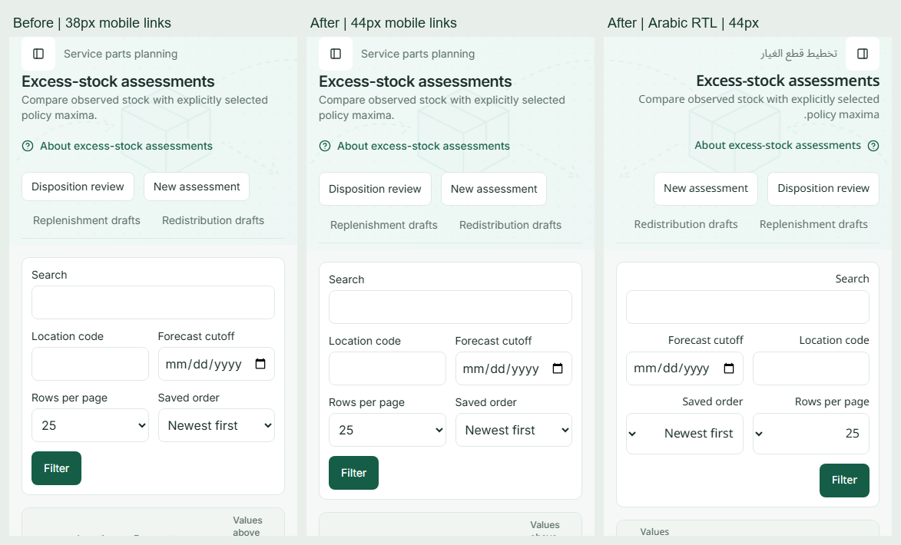
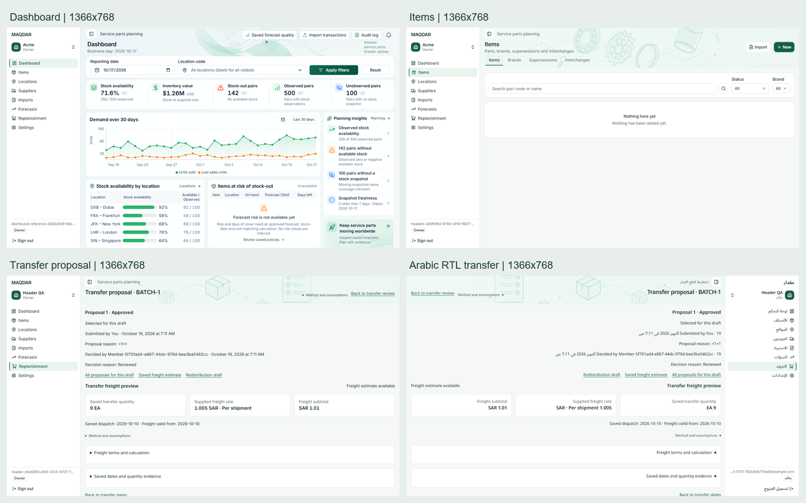
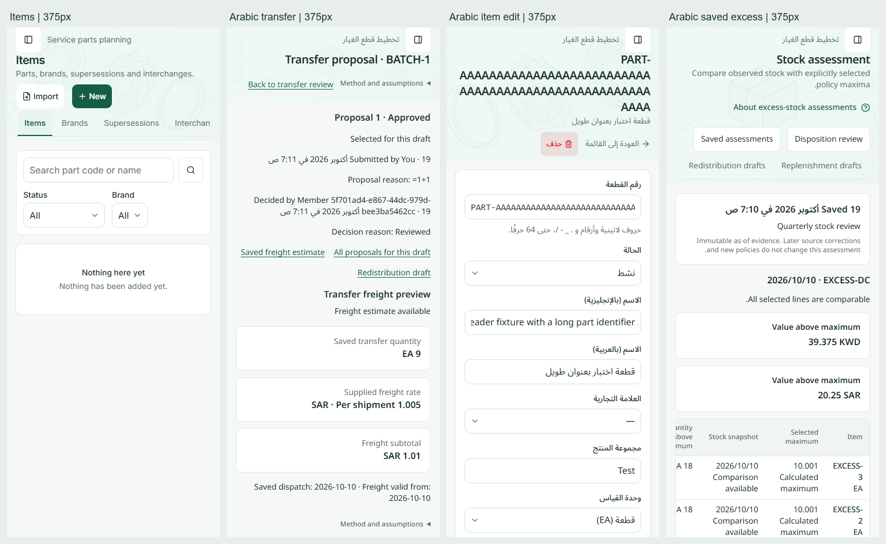

# Final merged-header visual check

Audit base: main `78555bd`, including PR #89's evidence typography correction and the approved login-heading exceptions in `design.MD`.

The new grouped excess-stock header actions rendered at 38px on mobile. Their extra flex wrapper prevented the existing `.page-actions > a` rules from applying; `design.MD` requires 44px mobile targets. A focused browser regression failed on unchanged main with **expected ≥44px, received 38px**.

The fix replaces that redundant wrapper with a fragment. The existing `PageHeader` flex container now owns wrapping and applies its shared link styles. Text remains 14px/20px, titles remain 20px/28px, and action order, destinations, permissions, section artwork and navigation are preserved. No shared CSS, financial formatting, queries or backend contracts change.

The new test checks list/create headers in English and Arabic RTL at 1280×800, 1366×768, 1440×900, 375×900 and 390×844, including actual target bounds, computed font roles and keyboard action order. Existing workflow tests cover preview/saved assessment headers and disposition review.

## Visual comparison

These are fresh captures from the actual local production build, using isolated local Supabase/Mailpit and existing test fixtures. The before capture is unchanged main; the after captures include this correction. The original screenshots are retained beside the comparison sheets.

Direct inspection covered the five target viewports, ordinary and event details/forms, long identifiers, mobile wrapping, RTL alignment, and the illustrated Imports loading state. The existing matrices also cover desktop, tablet, Settings permissions and Dashboard populated/empty states. No additional font-size mismatch was found in these views.

| Role                  | Observed size / line height | Samples |
| --------------------- | --------------------------- | ------- |
| Page title            | 20px / 28px, semibold       | 40      |
| Subtitle              | 14px / 20px                 | 30      |
| Sidebar navigation    | 14px / 20px                 | 216     |
| Record evidence value | 16px / 24px, semibold       | 155     |
| Method caption        | 12px / 16px                 | 65      |
| Button                | 14px / 20px                 | 15      |

[Typography summary](final-header-check-visuals/typography-summary.json): 521 sampled roles across 40 computed-style captures, with zero mismatches. Separately, [20 grouped-header observations](final-header-check-visuals/header-actions.json) cover 40 links in both locales at all five target viewports. Their text remains 14px/20px; mobile heights are now **44px**, while laptop heights remain **38px**, above the 36px desktop minimum. Locale font-family, viewport bounds and keyboard order assertions pass.

## Verification

Commands run from the repository root. Browser tests use `PLAYWRIGHT_BASE_URL=http://localhost:3120` and the isolated loopback database at port 55322; no hosted tenant is used.

| Check                                                                                                                                                                                                                                 | Result                                          |
| ------------------------------------------------------------------------------------------------------------------------------------------------------------------------------------------------------------------------------------- | ----------------------------------------------- |
| Baseline `excess-header.spec.ts` on unchanged main                                                                                                                                                                                    | Expected failure: 38px mobile target below 44px |
| `pnpm lint`                                                                                                                                                                                                                           | Passed                                          |
| `pnpm typecheck`                                                                                                                                                                                                                      | Passed                                          |
| `pnpm check:logical`                                                                                                                                                                                                                  | Passed                                          |
| `pnpm --filter web build`                                                                                                                                                                                                             | Passed                                          |
| `pnpm --filter web exec vitest run --maxWorkers=1`                                                                                                                                                                                    | Passed: 135 files, 1,569 tests                  |
| `pnpm --filter web test:e2e header-consistency.spec.ts responsive-planning.spec.ts dashboard-reference.spec.ts page-headers.spec.ts settings-workspace.spec.ts excess-stock.spec.ts excess-disposition.spec.ts excess-header.spec.ts` | Passed: 19 tests                                |
| `pnpm format:check`                                                                                                                                                                                                                   | Passed                                          |
| ECC frontend evidence checker                                                                                                                                                                                                         | Passed after rendered inspection                |
| `git diff --check`                                                                                                                                                                                                                    | Passed                                          |

The production change is limited to `ExcessStockHeader`'s redundant action wrapper. Both list/create consumers receive a focused browser regression; existing excess-stock and disposition workflow tests cover preview/saved/review consumers. The broader header matrix exercises existing loading/recovery boundaries, HTTP 404 behavior, keyboard navigation and scoped viewer access. Engine and database definitions are unchanged.

These are Chromium CSS-viewport checks at normal browser zoom, not a claim of physical-device or Safari testing. The login's larger headings are explicitly approved exceptions and remain unchanged. Existing English fallback copy in untranslated planning namespaces is outside this header-sizing correction. No deployment is authorized.
