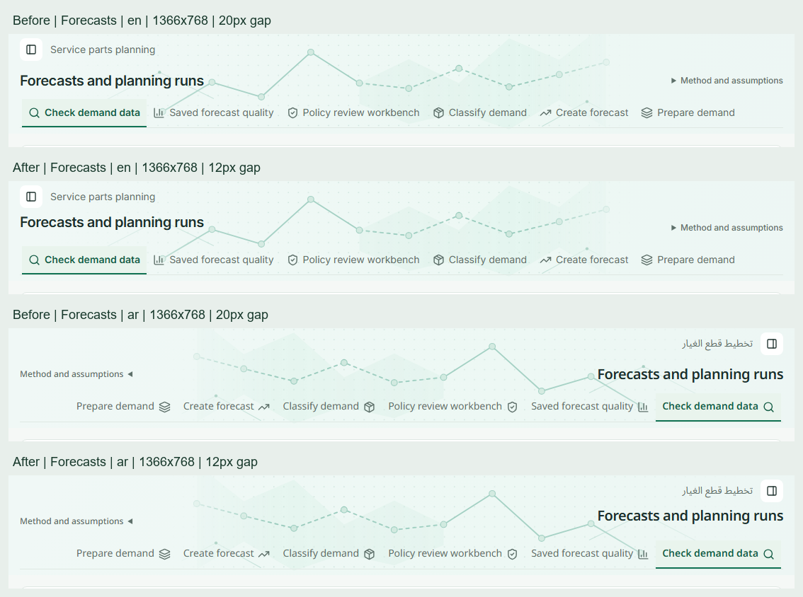
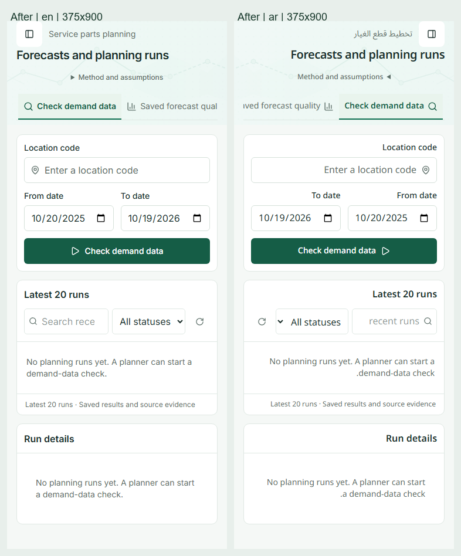

# Merged header audit and Forecasts alignment

Verified merged main `a86c1d7a61d4de0c674e6ed737e6580d77d714da` on 2026-10-19 against `design.MD`, using a local production build and isolated local Supabase. The user's primary checkout and unrelated work were preserved.

## Finding and correction

The Forecasts workspace title inherited vertical centering from the shared 44px header row. At 1366×768 and 1920×900, the tagline-to-title gap was 20px instead of the permitted maximum of 12px. The previous browser assertion checked this gap only on desktop English Items; its recorded measurements exposed the Forecasts discrepancy even though the baseline suite passed.

The title now uses `self-start` within its existing row. This moves its desktop text box up 8px and aligns the mobile title to the inline start. Typography, header dimensions, artwork, method controls, tab behavior, routes and planning semantics retain their existing definitions. The expanded regression checks the 12px maximum on all seven section headers in English and Arabic RTL, including mobile.

| Observation                              | Before | After |
| ---------------------------------------- | ------ | ----- |
| Forecasts gap, English 1366×768          | 20px   | 12px  |
| Forecasts gap, Arabic RTL 1366×768       | 20px   | 12px  |
| Largest gap across 35 section captures   | 20px   | 12px  |
| Items banner height, English/Arabic 1366 | 141px  | 141px |

## Typography and visual scope

Fresh post-fix computed styles contain 521 role samples across 40 capture records, with no type-scale mismatches:

| Role           | Samples | Size / line height | Weight                        |
| -------------- | ------- | ------------------ | ----------------------------- |
| Page title     | 40      | 20px / 28px        | 600                           |
| Subtitle       | 30      | 14px / 20px        | 400                           |
| Sidebar label  | 216     | 14px / 20px        | 400; 500 for the active label |
| Evidence value | 155     | 16px / 24px        | 600                           |
| Method caption | 65      | 12px / 16px        | 500                           |
| Button         | 15      | 14px / 20px        | 500                           |

The page-header matrix additionally asserts the actual Forecasts title's 20px/28px size. Font-family checks retain Inter first in English and Noto Sans Arabic first in RTL. Dashboard ↔ Items navigation, numeric/unavailable KPI roles, desktop/mobile inputs, long create/edit identifiers, transfer/purchase values, loading, error and HTTP 404 states were exercised. The initial 33-test audit also covered Settings Members/Invitations, permissions, disposition handoff batches and the recent mobile sign-in change. Its excess-header matrix checked 60 action links across 1280×800, 1366×768, 1440×900, 375×900 and 390×844 in both locales.

Post-fix section captures cover 1920×900, 1366×768 and 375×900 in English, and 1366×768/375×900 in Arabic RTL. Responsive planning additionally covers 375, 768, 1024, 1440 and 1920px; Forecasts tab workflows cover 375 and 1440px. Original captures and measured bounds are retained beside this report. Representative screenshots were inspected directly; generated PNG counts are not a claim that every artifact was manually reviewed.

## Verification

- Baseline browser audit: 33 passed.
- Expanded spacing assertion before the fix: failed as expected, `forecasts en 1920px`, received 20px against a 12px maximum.
- Post-fix section-header matrix: passed, all 35 observations at or below 12px.
- Complete web unit suite: 140 files, 1,606 tests passed.
- Production build, lint, strict typecheck and logical-utility checks: passed.
- Post-fix browser run: 14 passed; includes section headers, Forecasts tabs, responsive planning, Dashboard, detail/create/edit, loading and recovery checks.
- ECC rendered-evidence validation and final code diff review: passed. The implementation is one alignment utility on the Forecasts title; there are no business-logic, query, authorization or type-token changes.
- Repository formatting and `git diff --check`: passed.

This is Chromium verification at CSS viewports and normal browser zoom, not testing on physical 13-inch hardware or iOS Safari. Existing planning namespaces may use the documented English fallback in Arabic mode; this pass verifies type roles and RTL layout, not complete translation coverage. No new backend logic, schema changes, hosted data changes or deployment are included.

See [type measurements](forecast-header-alignment-visuals/typography-summary.json), [before bounds](forecast-header-alignment-visuals/before-header-bounds.json), [after bounds](forecast-header-alignment-visuals/after-header-bounds.json) and [rendered evidence](forecast-header-alignment-visuals/evidence.json).
