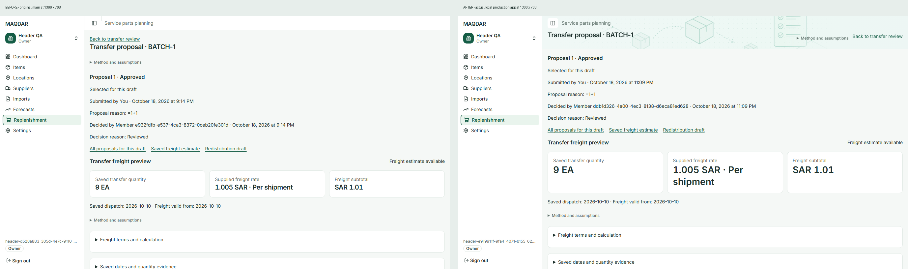
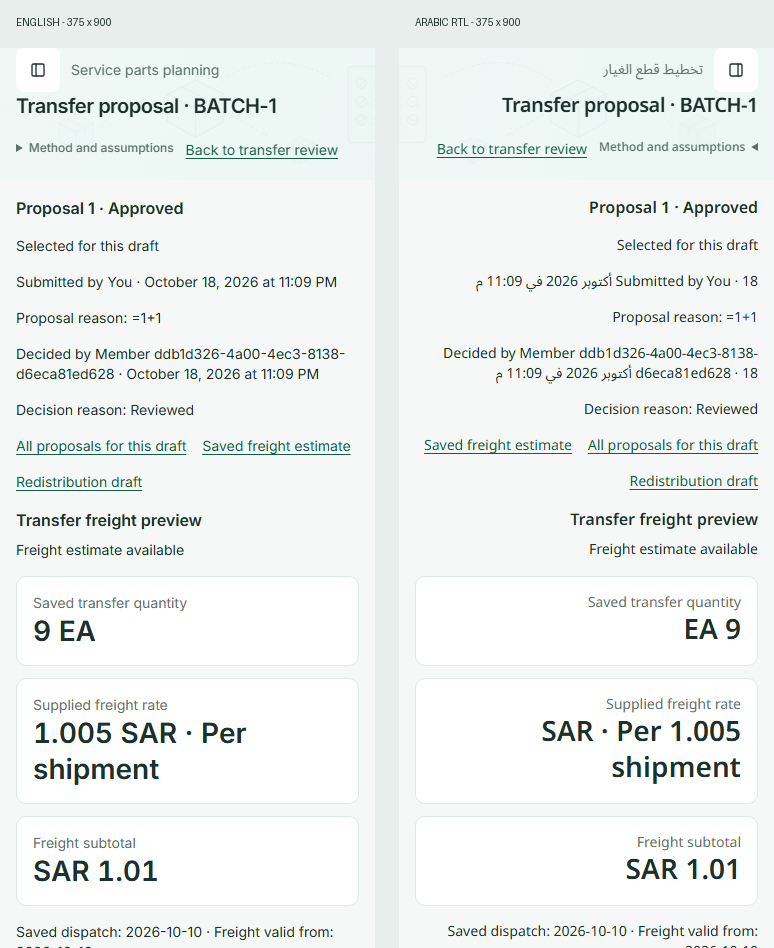

# Full application header consistency

The owner approved extending the existing illustrated header to detail, create/edit and loading pages after finding a plain Transfer Proposal detail header. The audit started from main `8a078f5` and includes main `c6eafd5`, preserving the subsequently merged event batches, read API and repeated-download fix. The [source inventory](header-consistency-visuals/routes.json) covers all 116 authenticated route files. Login and organization onboarding retain their separate shells. Dashboard retains its approved illustrated header.

## Acceptance contract

- Reuse the section artwork and shared PageHeader. Titles remain 20px/28px, body/navigation 14px/20px and captions 12px/16px. Preserve all existing text, translations, identifiers, controls and business evidence.
- Put existing back/source navigation in the header alongside its method disclosure and actions. Retain destinations, permissions, prefetch behavior and primary actions. Do not leave an extra navigation row above the artwork.
- Keep embedded Forecasts panels subordinate to their existing parent banner, with no duplicate artwork. Standalone routes always select their section pattern explicitly. Audit uses the existing Settings permissions motif.
- All six existing loading boundaries retain their placement and use their section's artwork, including the previously plain Imports operations fallback. Routes without a loading boundary deliver their complete server response with the illustrated header. No new ancestor streaming is introduced, so hidden-record HTTP 404 behavior remains intact. Existing list-only navigation placeholders and mobile wrapping are preserved.
- Add an executable guard for bare authenticated page titles and omitted PageHeader patterns, plus real browser coverage for the reported transfer proposal and representative detail/create/edit/loading routes.
- Inspect English 1920×900, 1366×768 and 375×900 and Arabic RTL laptop/mobile captures. Check keyboard back navigation, controls and long titles, shared typography, one banner, local table scrolling, loading, empty/error/permission states and existing workflows.

The direction remains a dense, quiet planning workspace. The mint artwork identifies the section without changing record status or implying any calculation. This is presentation only: no queries, RPCs, schema, unit/currency rules, evidence, forms or authorization changes. Rollback is the UI commit; no data recovery or deployment sequence is required.

## Typography audit

The follow-up font audit uses Items as the reference, without changing the approved scale. Page titles, subtitles, sidebar labels, back/actions and native controls are checked by computed size, line height, weight and font family. Shared controls, tab labels, table headings and disclosures use the corresponding font/line-height tokens. Mobile inputs retain 16px/24px and 44px targets. Planning metric cards use the existing 28px/36px token instead of inconsistent 20/24/30px utilities; prominent dates use 16px/24px. Forecast identifiers are raised from 11px to the existing 12px/16px caption role. The approved 13px help-panel exception remains isolated and unchanged. Full explanations stay below the header to avoid increasing its height.

Titles without subtitles align to the top of the same heading row, keeping the tagline-to-title gap at most 12px. Normal desktop detail/create headers occupy 100px including the 44px global bar. The Items workspace remains 140px including its tabs. Long identifiers and mobile actions wrap naturally; fonts are not reduced to force a fit.

## Route coverage and safeguards

| Area                                                            | Route files |
| --------------------------------------------------------------- | ----------: |
| Dashboard                                                       |           1 |
| Items                                                           |          12 |
| Locations                                                       |          12 |
| Suppliers                                                       |           9 |
| Imports                                                         |           3 |
| Forecasts                                                       |          18 |
| Replenishment, including ordinary/event purchases and transfers |          59 |
| Settings and Audit                                              |           2 |
| Total                                                           |         116 |

`PageHeader.pattern` is required; embedded Forecasts panels explicitly pass `undefined` under the existing parent banner. Existing back/source links use the new `back` slot, retaining destinations, permission conditions and prefetch behavior. Three contract checks reject omitted patterns, bare page titles, plain loading boundaries and headerless validation render branches. Generic recovery screens retain the section pattern, translated guidance, the visible 404 code and the existing English not-found sentence. Retry refreshes the server response without displaying exception details.

Loading boundary placement is unchanged. In particular, policy-list loading remains inside its existing list-only route group. Adding ancestor Suspense fallbacks would change late hidden-record `notFound()` HTTP statuses, so that approach is excluded by the design rules and downstream permission tests. Imports operations now use the same illustrated surface as history during their existing fallback. Tab rows scroll locally when needed; title and action containment checks do not require every off-screen tab to fit simultaneously.

## Actual browser comparison

The before capture is the real original Transfer Proposal page from main `8a078f5`. The after captures come from a local production Next.js build with actual loopback RPC fixtures, loaded fonts and 100% browser zoom. The comparison panels only place the untouched browser captures alongside one another.



The [50% overlay](header-consistency-visuals/before-after-overlay.png) makes the intentional heading/back-link reorganization visible. It also includes expected fixture-content differences; it is not a similarity score.



| View                   | Evidence                                                                                                                                                                                            |
| ---------------------- | --------------------------------------------------------------------------------------------------------------------------------------------------------------------------------------------------- |
| Desktop, 1920×900      | [Transfer detail](header-consistency-visuals/transfer-after-1920.png), [Import creation](header-consistency-visuals/import-create-en-1920.png)                                                      |
| Laptop, 1366×768       | [Transfer detail](header-consistency-visuals/transfer-after-1366.png), [Arabic RTL](header-consistency-visuals/transfer-ar-1366.png)                                                                |
| Mobile, 375×900        | [English](header-consistency-visuals/transfer-after-375.png), [Arabic RTL](header-consistency-visuals/transfer-ar-375.png), [long Item identifier](header-consistency-visuals/item-edit-ar-375.png) |
| Real throttled loading | [Import creation](header-consistency-visuals/loading-import-1366.png)                                                                                                                               |
| Recovery               | [Arabic error](header-consistency-visuals/forecast-error-ar-1366.png), [Arabic not found](header-consistency-visuals/not-found-ar-375.png)                                                          |
| Measured type roles    | [Computed browser styles](header-consistency-visuals/typography.json)                                                                                                                               |

Fixture names, record values, timestamps and reviewer identities differ from the owner's production screenshot. Existing untranslated planning copy still uses the application's English fallback in RTL; the new recovery/loading messages are translated. Global invitation notices retain their existing placement and can add space above the page heading. No perceptual-similarity percentage or complete assistive-technology audit is claimed.

## Verification and reproduction

Use the [regression ledger](REGRESSION.md) for downstream dependencies. Commands run from the repository root with the local stack's `.env.local`, `PLAYWRIGHT_BASE_URL` and `MAQDAR_TEST_DSN`. Database/browser suites run sequentially.

```text
pnpm lint
pnpm typecheck
pnpm test
pnpm check:logical
pnpm format:check
pnpm --filter web build
pnpm --filter web test:e2e
pnpm --filter web test:tabs
```

The full local browser sweep exercised the existing workflows, including 100,000-row demand import, 50,000-item list performance, permissions, stale forms, independent reviews, stock evidence, responsive layouts and RTL. Regression corrections retain the old 404 label/copy and response semantics, update the obsolete Import-create plain-header expectation, and distinguish intentional tab scrolling and the two Imports fallback components. The corrected/dependent suites are rerun on the integrated production build. The PR checks provide the complete fresh-stack CI result. Unit coverage instrumentation is not enabled or claimed.

Local closeout on 2026-10-19:

- Production build, strict types, lint, logical utilities and all 1,530 unit tests pass.
- The initial 97-case sweep found six regressions and left two serial dependents unrun. All were addressed and covered in the 37-workflow affected/dependent rerun. That rerun passed 35 cases; its two Settings staging-selector races passed in a fresh invocation after fixing the helper to require exactly one visible workspace. No permission or timeout assertions were weakened.
- A final consecutive six-case header/typography run passes and supplies the committed screenshots and computed styles. It includes real loading, retry/return behavior, 404 status, validation branches, long identifiers and desktop/mobile/RTL matrices.
- All 16 separate tab/help browser cases pass. The first cold Vite navigation exceeded the unchanged 30-second test timeout; rerunning the same suite after compilation passed 16/16.
- The ECC visual-evidence checker accepts the local record; the actual rendered screenshots, comparison and overlay were inspected. The full initial sweep's three optional large-fixture cases remain conditional skips, rather than claims of measured performance for those absent datasets.

Keep raw screenshots outside another Playwright configuration's output directory, or copy them to the documentation directory first: Playwright clears its output directory at startup. The retained visual rerun uses a dedicated root `test-results/header-visual-final` folder, separate from the tab fixture output.
