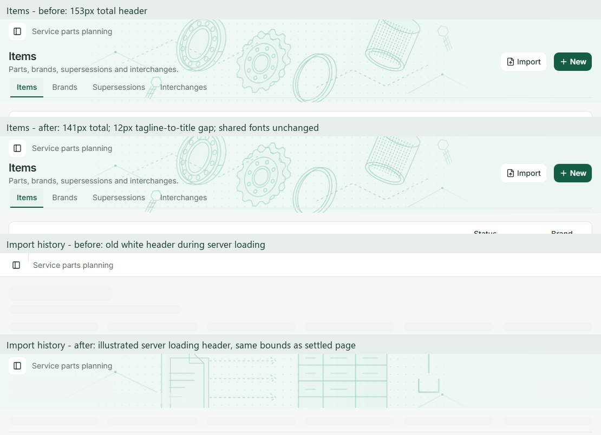

# Header loading consistency and spacing

The owner reported Import history briefly showing the old white header and highlighted excess space between “Service parts planning” and the Items heading. This follow-up keeps the existing illustrated header family and shared typography.

## Contract

- Import history uses its mint mapping illustration during the server loading fallback and after loading, without a change in header geometry.
- Preserve `/imports`, its URL filters, editor authorization, queries and history behavior. URL-neutral `(history)` and `(operations)` route groups separate the loading boundaries, so history cannot prefetch the old parent fallback. The wizard and detail screens retain their existing plain headers and loading fallback.
- Remove the illustrated page's 8px top padding and reduce its minimum heading row from 52px to 48px. Adjust the artwork's top offset to the retained 44px global bar.
- At desktop/laptop widths, the tagline-to-title text-box gap is at most 12px; the Items header with tabs is at most 144px. Keep the 4–8px subtitle-to-tabs gap, 20px/28px title, 14px/20px body/navigation and mobile 44px controls.
- Verify 1920×900, 1366×768 and 375×900 layouts, Arabic RTL, keyboard controls, and the existing Dashboard typography/navigation regressions.

## States and verification plan

The loading regression throttles the real production response during direct entry and reload, observes the actual server fallback, then restores normal throughput and verifies equal loading/settled header bounds. It also checks sidebar navigation and the wizard's retained plain header. It does not replace response markup or add application delay hooks. The regression failed against the original production bundle because the loading header had no illustrated banner.

Empty/success/permission behavior uses the existing Import and master-data workflows. This change introduces no partial-data calculation or error controller; existing error handling and authorization remain in the page/data components. No backend, migration or financial/planning logic changes are included.

## Rendered comparison

The Items header measures **141px instead of 153px** at both 1920px and 1366px. The tagline-to-title text-box gap is **12px**; the subtitle-to-tabs gap is **4px**. The transparent bar's old 1px border was removed so its text and controls align to whole pixels. The illustration still extends through the tabs. Mobile wraps naturally rather than using a fixed header height.

Import history's loading and settled backgrounds both measure **1110×100px at x=256, y=0** on the 1366×768 viewport, on direct entry and reload. The loading capture is taken while the complete server fallback remains visible; the test waits for its heading/actions to finish parsing before measuring it, then checks that the fallback remains present through the screenshot. This avoids mistaking the later table-only skeleton for the route fallback.

[Desktop](header-loading-visuals/items-en-1920.png), [laptop](header-loading-visuals/items-en-1366.png), [mobile](header-loading-visuals/items-en-375.png), [Arabic laptop](header-loading-visuals/items-ar-1366.png), [Arabic mobile](header-loading-visuals/items-ar-375.png), [loading](header-loading-visuals/imports-loading-entry-1366.png), and [settled Import history](header-loading-visuals/imports-loaded-entry-1366.png).

The [50% overlay](header-loading-visuals/items-overlay.png) compares the same 1366px viewport without rescaling. It shows the intended vertical movement; fonts, actions and unrelated content retain their existing styles. No perceptual-similarity score is claimed.

## Completed checks

- Production build, strict typecheck, repository lint, logical CSS, formatting and diff/secret review passed.
- All **1295 web unit tests** passed. Coverage was not collected for this presentation change.
- **26 distinct Playwright tests** passed: the loading regression, all seven illustrated sections at three English and two Arabic widths, Dashboard reference checks, five responsive widths, Forecasts tabs, master-data workflows and Import workflows/permissions. The affected layout suites were rerun after the final spacing correction.
- Rendered desktop/laptop/mobile/RTL captures were inspected. Keyboard Import → New focus and decorative artwork semantics/pointer behavior passed. No automated axe audit was run.

The shared typography and loading rules are recorded in [design.MD](../design.MD). No backend/schema changes, merge or deployment are included.
