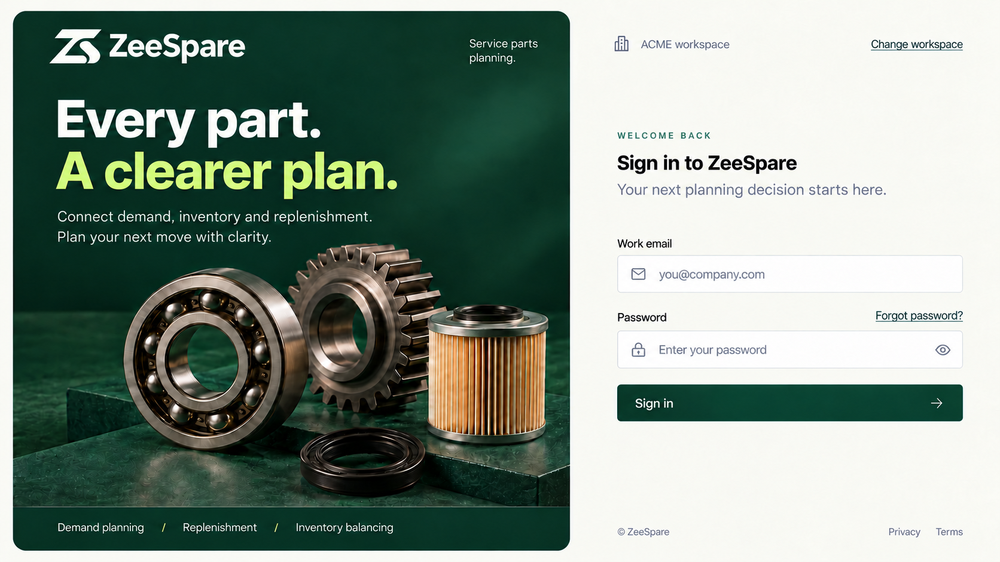
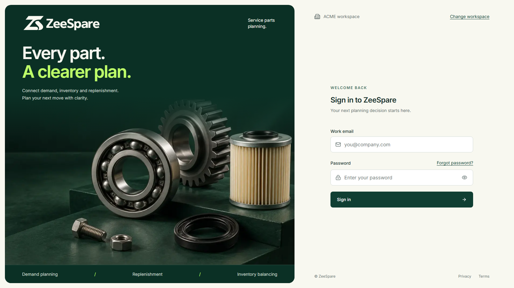

# Industrial Studio sign-in

Approved on 2026-10-21: implement the Industrial Studio mockup using the supplied Precision logo, a compact 24px sign-in heading, password sign-in and password recovery. Remove the email sign-in button and invitation notice. Authenticated application typography, planning logic and tenant authorization are unchanged.

## Implementation

- A shared, localized auth shell renders the sign-in, recovery-request, email-confirmation and new-password pages. The desktop layout uses a forest parts photograph panel and an ivory form panel. Mobile keeps the logo and form; decorative imagery is hidden.
- Heading: 24px/32px, weight 600. Body and controls follow `design.MD`; inputs use 16px text to avoid mobile zoom. Interactive targets are at least 44px high.
- The exact outlined logo comes from `C:/projects/zeespare_web/design/precision/svg/zeespare-horizontal-reversed.svg`. The photograph comes from that website repository's `src/assets/imagery/service-parts.png`, encoded as a 1536×1024 WebP (approximately 130 KiB). Both are served locally, with no third-party image request.
- Workspace identity comes from the validated request host. No sample organization is hard-coded. Existing email/invitation callbacks remain compatible with previously issued links.

## Password recovery

The request action validates the email and uses Supabase's recovery API with a destination derived from the validated site origin. Unknown accounts and account-dependent rate-limit responses receive the same neutral message. Recovery never creates an account.

The email contains a single-use recovery token. GET renders a confirmation without consuming it, so ordinary mail scanners and reloads do not invalidate the link. A deliberate server-action POST verifies it as a recovery token, establishes the session and redirects to the password form. Default-template PKCE callbacks are also accepted when their verifier cookie is available. The supplied token template supports opening the email in a different browser.

Updating a password requires verified claims, matching confirmation and the existing eight-character minimum. The existing authenticated password action performs the update. Destinations are fixed by the server; submitted redirect parameters are ignored. Existing same-origin checks remain in force. Passwords and tokens are not logged or returned in action error state.

## Deployment dependency

No hosted configuration or deployment is performed by this change. Before deployment, the Supabase project owner must apply `supabase/templates/recovery.html` as the recovery email template and allow the exact `/auth/recover` URL for each deployed workspace origin (for example `https://acme.zeespare.com/auth/recover`). Keep existing invitation callback URLs. The repository config covers local development; changing it alone does not update hosted Auth settings. See the official [Supabase email-template documentation](https://supabase.com/docs/guides/auth/auth-email-templates).

## Verification

The implementation includes recovery-action unit tests and browser tests for an actual local recovery email, GET/reload safety, single-use enforcement, password confirmation, login with the new password, invalid links, mobile layout and Arabic RTL recovery.

Anonymous sign-in remains English under the existing locale policy; Arabic recovery was checked using an actual Arabic-enabled organization session, without changing that policy.

Validation against the local production build:

- Workspace lint, typecheck and logical-utility checks passed. The production Next.js build passed.
- All 1,881 web unit tests passed, including 19 recovery-action tests; all 13 simulation-worker tests passed. Two source-scanning tests initially timed out during a concurrent build; the complete web suite passed with two workers afterward.
- 12 login layout/interaction tests passed across 320×568 through 1672×941, including 1366×768 laptops, keyboard navigation, password visibility and 200% text enlargement.
- All 25 recovery, invitation, smoke and workspace-boundary browser checks passed using actual local Supabase and Mailpit. The reset test opens the real email in a fresh browser, verifies ACME host-only cookies, rejects password mismatch and token reuse, and checks both old-password rejection and new-password login.
- No database migration, planning engine, permission or RLS changes are included. The full database and engine suites remain covered by PR CI rather than being claimed as local checks.

## Visual comparison

Compared actual Chromium screenshots of the production build with the approved mockup. The form uses real 24px headings, 14px body text and 16px inputs rather than the generated mockup's approximate text rendering. The supplied website photograph includes the bolt and nut; its crop and lighting differ from the generated concept. The same split composition, parts imagery, logo, colors and password-only form are retained. No numerical similarity score is claimed.

| Approved concept                                                                           | Actual implementation, 1672×941                                           |
| ------------------------------------------------------------------------------------------ | ------------------------------------------------------------------------- |
|  |  |

Additional captures:

- [13-inch laptop, 1366×768](industrial-studio-login-visuals/laptop-1366.png)
- [Small phone, 320×568](industrial-studio-login-visuals/mobile-320.png) and [390×844](industrial-studio-login-visuals/mobile-390.png)
- [Mobile with 200% text](industrial-studio-login-visuals/mobile-text-200.png)
- [Arabic RTL laptop recovery](industrial-studio-login-visuals/recovery-ar-laptop.png) and [Arabic mobile recovery](industrial-studio-login-visuals/recovery-ar-mobile.png)
- [New-password form](industrial-studio-login-visuals/reset-password.png)

The screenshot review confirmed compact headings, visible primary/reset actions, logical RTL alignment, an unmirrored logo and no horizontal page overflow at the tested sizes. Decorative artwork is hidden on mobile to prioritize the form.
