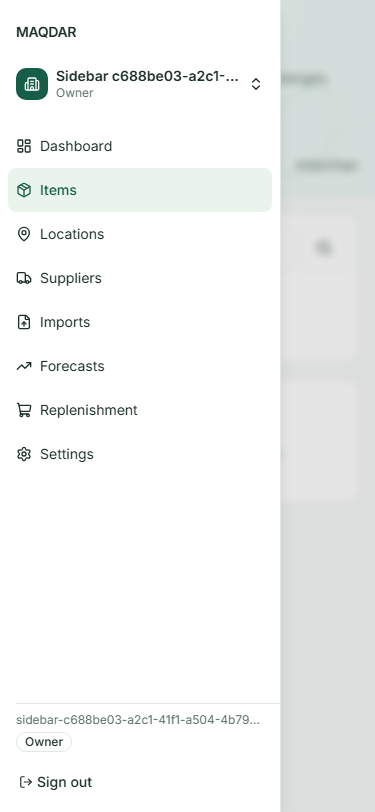
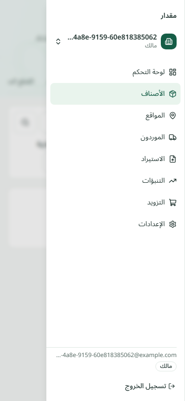
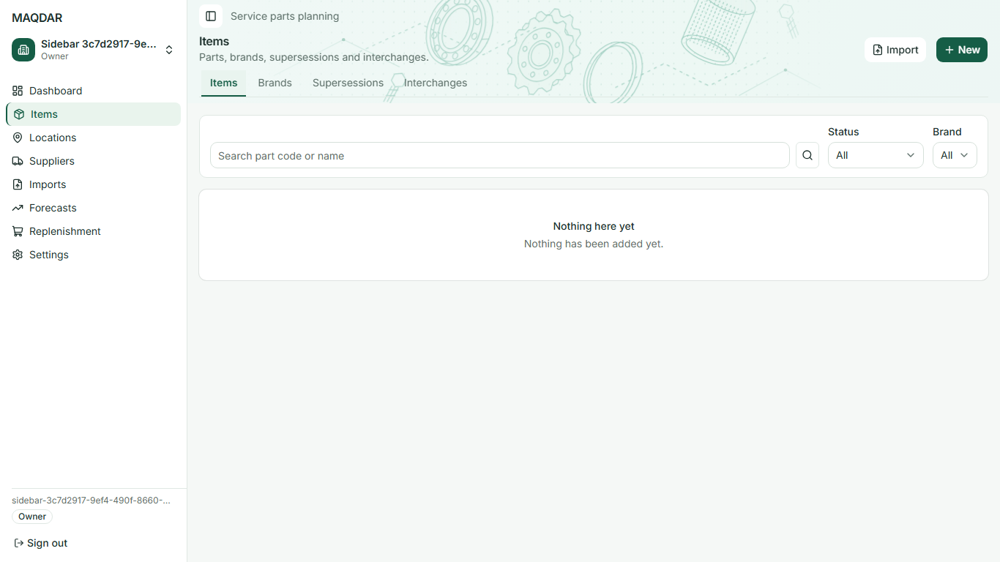
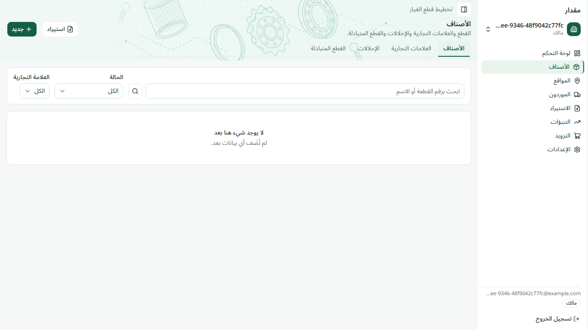

# Merged header verification and mobile sidebar targets

The 2026-10-20 audit used a local production build of merged main `f5337c0`. The approved compact font scale is already applied: 16px/24px/600 page titles, 14px/20px/600 record values, 14px/20px navigation/body/actions, and 12px/16px captions. No further font reduction is required.

Fresh laptop, mobile and Arabic RTL checks passed 31 existing browser cases. They include Dashboard ↔ Items navigation, all section banners, detail/create/edit routes, loading/error states, Settings and disposition/simulation evidence. The retained audit has 623 computed-style observations across 70 captures with no font-role mismatch, 35 section-header measurements with a maximum 12px tagline-to-title gap, and 80 header-action measurements. An additional 32-page DPR2/touch audit found no shared title/subtitle/navigation mismatch; sampled shared header contrast was at least 4.77:1 on the mint surface.

The final open-drawer check found a separate design-rule inconsistency: navigation rows were 32px high and the brand link was 24px on mobile. Their text was already 14px/20px. The new regression assertions reproduced the 32px failure in both English and Arabic before the fix.

## Focused correction

`AppSidebar` now supplies a 44px minimum height to navigation links and the brand link below 768px. Only the mobile brand hit area uses flex centering. Navigation text remains 14px/20px, icons remain 16px, and desktop navigation remains 32px high. The app-owned classes also work inside the portalled drawer; the generated sidebar primitive is untouched.

Routing, modified-click behavior, current-page dismissal, keyboard navigation, Escape focus return, desktop collapse state, tenant/role permissions and data queries are preserved. `design.MD` now makes the mobile/desktop target distinction explicit without changing the font scale.

## Actual screenshots

These post-fix captures use synthetic local fixtures. The fully open drawer images use a 375×812 CSS viewport with opening animations disabled for the capture. Laptop captures use 1366×768. The saved measurements retain the actual pre-fix and post-fix target sizes.

English mobile after:

Arabic RTL mobile after:

English laptop after:

Arabic RTL laptop after:

## Verification

- The initial 31-case production-browser audit passed. Its font-role summary is retained in [font-audit.json](merged-header-mobile-targets-visuals/font-audit.json).
- The new mobile-target guard failed against the unchanged baseline in both languages, receiving 32px instead of the required 44px.
- The corrected production build, strict types, lint, logical-utility checks and complete web unit suite passed: 142 files / 1,644 tests.
- All 11 downstream browser cases passed: Dashboard reference, section headers, mobile navigation and the five responsive-planning widths. The four navigation cases then passed again with stable opening-animation-disabled screenshots. No retries, skips, deadlines or functional assertions were relaxed.
- Actual [drawer measurements](merged-header-mobile-targets-visuals/drawer-measurements.json) show 44px targets with 14px/20px text in both languages. The laptop cases enforce 32px navigation rows, 16px icons and the shared 16px page title.
- Representative laptop/mobile/RTL images were inspected directly. The ECC local evidence record includes these captures and the baseline header/state matrix; its validator passed. Coverage instrumentation was not collected for this presentation change.

These are Chromium CSS viewport, DPR and touch-emulation checks, not physical laptop or iOS Safari tests. Existing Arabic planning-string fallbacks remain outside this typography/target-size correction. No deployment is included.
