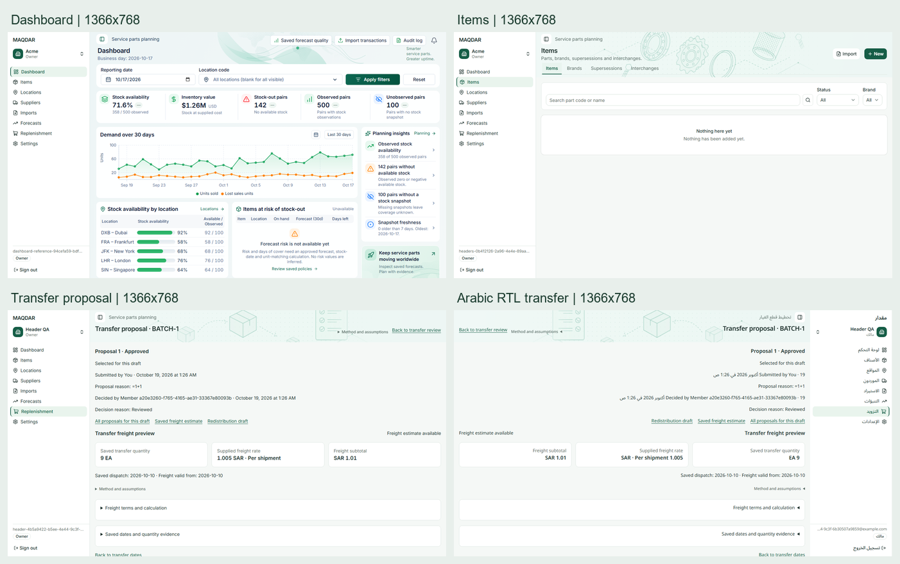
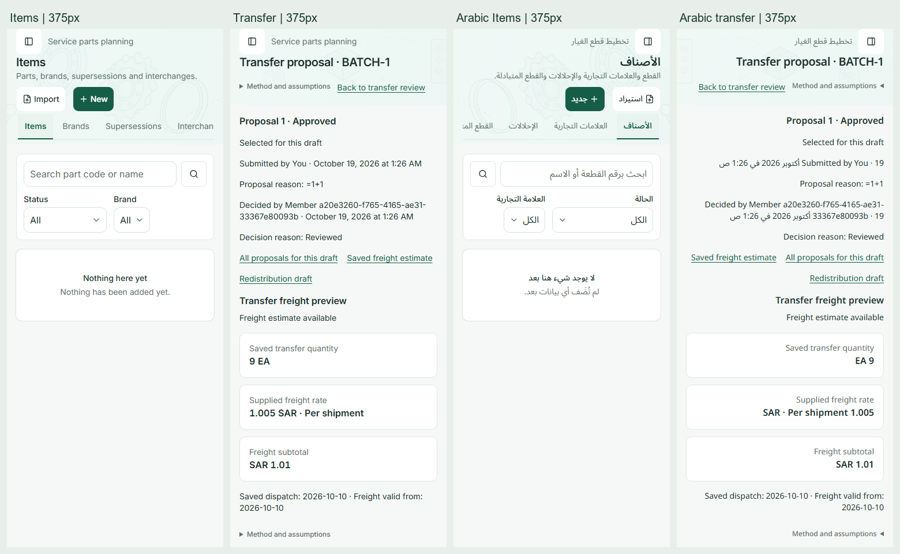
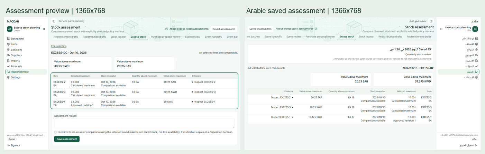

# Merged header and typography verification

Audit base: main `030a196`, including the header pass in PR #84, Dashboard metric wrapping in PR #87 and excess-stock assessments in PR #86. Items remains the reference in [design.MD](../design.MD).

The existing merged headers and sizes match the shared design roles in the initial browser matrix. The one implementation correction is the newly merged excess-stock currency-total card: use `text-evidence-value` instead of `text-section-title`. Both currently resolve to 16px/24px semibold, so this deliberately preserves the rendered size while preventing future heading changes from changing record values. No layout, query, calculation, formatting, permission or backend contract changes.

The excess-stock browser test now checks values at 1366×768 and other existing desktop/mobile sizes, plus saved Arabic RTL evidence at 375px and 1366×768. It asserts actual font size, line height, weight and font family, alongside the 20px title and existing 14px table rows.

## Verification

| Check                                     | Result                                      |
| ----------------------------------------- | ------------------------------------------- |
| Production Next.js build                  | Passed                                      |
| Repository lint and strict typecheck      | Passed                                      |
| Logical CSS utilities                     | Passed                                      |
| Complete web unit suite                   | 134 files, 1,556 tests passed               |
| Selected application browser suites below | 17 passed, no retries or skips              |
| Repository formatting and diff whitespace | Passed                                      |
| ECC rendered-evidence checker             | Passed; screenshots also inspected directly |

The 40 typography captures contain 521 measurements of titles, subtitles, navigation, evidence values, method captions and buttons, with no mismatches against their expected roles. The excess-stock workflow separately asserts preview and saved RTL currency-total values. See the [computed typography summary](merged-header-verification-visuals/typography-summary.json) and [rendered evidence record](merged-header-verification-visuals/evidence.json).

Items' measured desktop/laptop banner is 141px including the global bar and tabs, within the 144px limit. The tagline-to-title text-box gap is 12px. Sidebar labels remain 14px/20px with 16px icons and 32px desktop rows during Dashboard ↔ Items navigation. Mobile controls retain the documented 16px/24px input text and 44px targets. Existing detail/create/edit, error, not-found and throttled Imports/Settings loading checks passed without a plain-header swap.

Browser command, run sequentially against a local production build and isolated loopback Supabase:

```sh
pnpm --filter web test:e2e header-consistency.spec.ts responsive-planning.spec.ts dashboard-reference.spec.ts page-headers.spec.ts settings-workspace.spec.ts excess-stock.spec.ts
```

The audit uses normal browser zoom in Chromium at CSS viewports, including 1366×768 laptop, 375×900 mobile, 1920px desktop and Arabic RTL. This is browser viewport verification, not a claim of physical-device or Safari testing. Existing English fallback strings in untranslated planning namespaces remain outside this typography-only change.

The initial run's additional permissions case encountered a local callback-port mismatch. Aligning the isolated app and Auth service to port 3120 resolved it; the final 17-case run above includes the passing permissions case. Optional local Supabase Studio/telemetry service health checks did not pass on this Windows host; the final run used healthy loopback Database, REST, Auth and Mailpit services. No hosted settings or production data changed.

## Actual screenshots

These are current production-build captures with local fixtures, not design mockups. Contact sheets scale the original captures uniformly; individual source PNGs are retained beside them.







The excess-stock preview and saved-state images show different phases of the existing immutable-history test. That test changes a stock snapshot before saving; the differing amounts are fixture behavior and are unaffected by this font-token correction. Mobile originals: [preview](merged-header-verification-visuals/excess-375.png), [saved Arabic RTL](merged-header-verification-visuals/excess-ar-375.png).

No remaining header or font-size inconsistency was observed in the tested states. The implementation patch preserves current sizes and prevents a future section-heading change from enlarging assessment values. No merge or deployment was performed.
