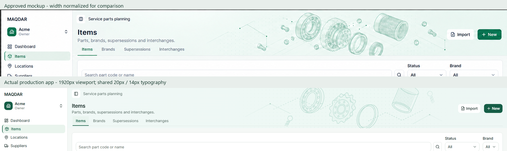

# Compact illustrated page headers

The owner approved the Items mockup after extending its artwork through the section tabs and removing the excess subtitle-to-tabs gap. The main sections now share that compact mint header treatment, with page-specific SVG motifs and the typography required by [design.MD](../design.MD).

| Section       | Decorative motif                     | Scope                                                           |
| ------------- | ------------------------------------ | --------------------------------------------------------------- |
| Items         | Bearing, gear, filter and fasteners  | All master-data area tabs                                       |
| Locations     | Pins and location network            | All master-data area tabs                                       |
| Suppliers     | Partner/factory supply nodes         | All master-data area tabs                                       |
| Imports       | Documents and column mapping         | Import history                                                  |
| Forecasts     | Curve and confidence envelope        | Main planning workspace, including its six tabs                 |
| Replenishment | Cartons, inbound paths and checklist | Purchasing and redistribution workspaces with shared navigation |
| Settings      | Sliders, gears and permission nodes  | Main settings page                                              |

Detail/edit screens retain their existing hierarchy. No business logic, queries, authorization rules, RPCs, currencies or dependencies change.

## Composition

`PageHeader` accepts a typed pattern and a navigation slot. Its background extends behind the existing global bar and through the section tabs. Forecasts passes server-rendered heading/artwork into its existing client tab component; selected panels and form state keep the same behavior. The SVG artwork is synchronous, decorative, hidden from assistive technology and cannot intercept input. RTL mirrors its placement; mobile reduces its prominence and preserves wrapping and 44px controls.

At 1920px and 1366px, the Items header measures **153px including the global bar and tabs**. The subtitle-to-tabs gap is **6px**. Typography stays at **20px / 28px** for page titles and **14px / 20px** for body/navigation text. Compactness comes from spacing, without shrinking text.

The SVG rendition keeps the approved parts motif; fine shading and mechanical drawing details differ from the generated concept. Actual font sizes follow the shared design rules. Comparison images normalize the mockup width for viewing; no perceptual-similarity percentage is claimed.

## Actual screenshots

[Items desktop](page-header-visuals/items-en-1920.png), [1366px laptop](page-header-visuals/items-en-1366.png), [375px mobile](page-header-visuals/items-en-375.png), [Arabic laptop](page-header-visuals/items-ar-1366.png), and [Arabic mobile](page-header-visuals/items-ar-375.png).

[Locations](page-header-visuals/locations-en-1920.png), [Suppliers](page-header-visuals/suppliers-en-1920.png), [Imports](page-header-visuals/imports-en-1920.png), [Forecasts](page-header-visuals/forecasts-en-1920.png), [Replenishment](page-header-visuals/replenishment-en-1920.png), and [Settings](page-header-visuals/settings-en-1920.png).

[Seven-section header gallery](page-header-visuals/header-gallery.png).

Measured bounds and the rendered-evidence record are included with these captures. The evidence checker validates completeness; rendered screenshots and browser tests provide the actual observations.

## Verification

Local checks passed: production build, strict typecheck, lint, logical CSS, formatting, all **1295 unit tests**, and **19 Playwright tests** covering the new header family, Dashboard reference, responsive layouts, Forecasts tabs and master-data workflows/permissions. The visual test captured all seven sections at three English and two Arabic viewport sizes with no browser errors. Coverage was not collected for this presentation change.

The application changes are limited to header composition, CSS and decorative SVG. No new user-visible copy or backend work is introduced.
