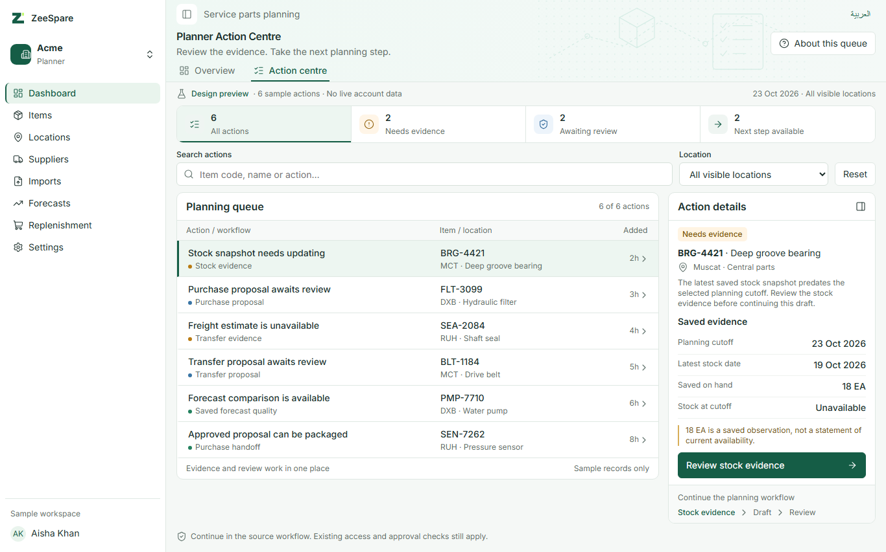
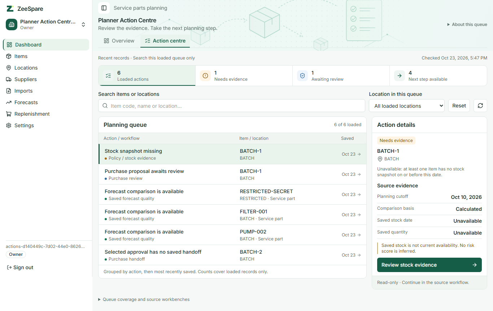

# Planner Action Centre

Approved 2026-10-23. Open **Dashboard → Action centre** (`/dashboard/actions`). This read-only workspace brings existing saved evidence together; it does not approve proposals, reserve stock, create orders or change planning calculations.

## Data contract

| Queue source      | Existing data                                 | Inclusion and destination                                                                                                                                                             |
| ----------------- | --------------------------------------------- | ------------------------------------------------------------------------------------------------------------------------------------------------------------------------------------- |
| Needs evidence    | `policy_workbench`, `policy_stock_comparison` | Check the ten latest visible policies at their original cutoff with calculated basis. Include existing RPC outcomes other than `available`; link to the exact policy, date and basis. |
| Purchase review   | `purchase_review_list`                        | Up to 25 recent pending proposals; open the existing proposal review.                                                                                                                 |
| Transfer review   | `transfer_review_list`                        | Up to 25 recent pending proposals; retain access requirements for both endpoints and open the existing review.                                                                        |
| Forecast evidence | `forecast_quality`                            | Up to 25 recent selected results; open the exact saved run and item. Viewing does not mark a result read or remove it.                                                                |
| Purchase handoff  | `purchase_review_list`, `purchase_handoffs`   | Examine up to 25 recent selected approvals, excluding proposals with an existing handoff. Open the approved proposal; eligibility is rechecked by the source workflow.                |

Each source reads one additional row to detect truncation. Limits apply before in-memory search/location filters and before handoff exclusion. Counts describe loaded records, not all pending work. Source links expose the complete workbenches. The queue groups evidence, review and next steps, then sorts by saved timestamp and ID. For stock entries, “Saved” is the policy completion time; “Checked” is the current request time. This is not an issue age or an inferred freshness deadline.

Unavailable freight previews are not persisted as historical alerts and therefore are not included. Policy override, event, excess, network and regional review queues are also outside this first version. No unavailable-preview alert, risk score, days-of-cover formula, personal assignment or unread-state backend is invented.

## Safety and performance

The server uses the user's session client, explicit active-organization filters and existing security-invoker views/RPC authorization. No service-role client, new grants, migrations, write actions or API contract changes are introduced. The branch-visible results alone determine counts, search contents and location choices. Downstream independent-approval, currency, units, stock freshness and package eligibility checks remain authoritative.

Five bounded source readers run concurrently. The stock reader makes at most ten RPC calls, in groups of five; each database request has a 15-second timeout. Forecast queries fetch only queue metadata, not potentially large saved evidence arrays. Individual source failures retain successful records, display an incomplete-queue warning and identify failed sources. If every source fails, totals show a dash and the queue displays an unavailable state. Exceptions never expose raw database errors.

The UI preserves quantity/monetary decimal strings and uses existing currency-specific formatters. Date-only values use UTC date formatting; timestamps use the organization's locale/time zone. Source detail pages provide full evidence. Shared title/body/evidence tokens and the existing shell remain unchanged.

## Verification

Automated tests cover source bounds, explicit organization filters, malformed/failed sources, action inclusion, exact decimal retention and normalized Arabic search. Production Playwright tests seed local-only records through existing purchase/transfer approval chains and test source navigation, search/reset, branch/tenant isolation, both-endpoint transfer access, signed-out redirect, empty state and computed typography/touch targets. Test-only fixtures never populate production data.

### Visual comparison

The production page is compared with the approved mockup using actual browser screenshots. Local fixtures exercise real saved records and RPCs; the application contains no sample queue. Captures cover 1280×800 and 1366×768 laptops, 390×844 and 320×568 phones in English and Arabic RTL, plus empty and selected-detail states.

The compact summary, queue/detail split, green selected row, source evidence and action placement follow the mockup. The app retains its shared shell, artwork and 16/14/12px typography. Form labels are 14px; mobile input text is 16px and targets are at least 44px. Directional arrows and logical spacing mirror in RTL. On mobile the queue scrolls locally and selecting a row focuses its evidence panel below.

Intentional differences: real saved dates replace sample relative issue ages; actual source states/counts replace sample metrics; the unavailable-freight sample is omitted because it has no persisted source. Source limits, failure warnings and coverage links are explicit. Dashboard's existing action bar supplies the entry link without moving its reference panels. Screenshot review corrected a wrapped location icon and removed repeated stock explanations so the laptop action remains visible without reducing the shared font sizes.

| Approved mockup                                                              | Production implementation, local records                                        |
| ---------------------------------------------------------------------------- | ------------------------------------------------------------------------------- |
|  |  |

[Arabic laptop](planner-action-centre-visuals/planner-actions-ar-1366.png) · [English phone](planner-action-centre-visuals/planner-actions-en-390.png) · [Arabic phone](planner-action-centre-visuals/planner-actions-ar-390.png) · [Narrow Arabic phone](planner-action-centre-visuals/planner-actions-ar-320.png) · [Mobile selected action](planner-action-centre-visuals/planner-action-detail-en-390.png) · [Empty queue](planner-action-centre-visuals/planner-actions-empty.png)

### Checks

- Repository lint, typecheck, logical-utility check and production build passed.
- Web unit suite: 2,207 tests passed across 202 files (`vitest run --maxWorkers=2`). An initial unconstrained run during a build timed out in existing source-scanning tests; the complete bounded run passed. Simulation supervisor: 13 tests passed.
- Engine unit run: 498 passed; 1,038 database/environment-gated cases skipped with no engine DSN configured.
- Focused pgTAP: 355 assertions across nine files passed (tenant RLS, privileges, forecast baselines, policy workbench, stock/prepared-stock comparisons, purchase review/handoffs and transfer review). A broader exploratory database run was interrupted; it is not reported as a full-suite pass.
- Production-browser acceptance: 14 scenarios passed across the final regression runs: Action Centre (2), Dashboard reference/isolation (2), mobile sidebar in both locales (4), shared header matrix (1) and responsive planning at five widths (5). The new spec additionally checks 1280, 1366, 390 and 320px in both locales. Early test failures corrected an oversized Dashboard offset, accessible control labels and selectors that encountered Next's transient hidden streamed tree; the final source destinations and visible-tree assertions pass without retries.

Manual code/security review checked the session-only query path, active-tenant filters, branch-derived counts/options, bounded reads, decimal preservation, safe error copy and source-only mutations. No new dependency, migration or API scope is required. No hosted database changes, merge or deployment were performed.
