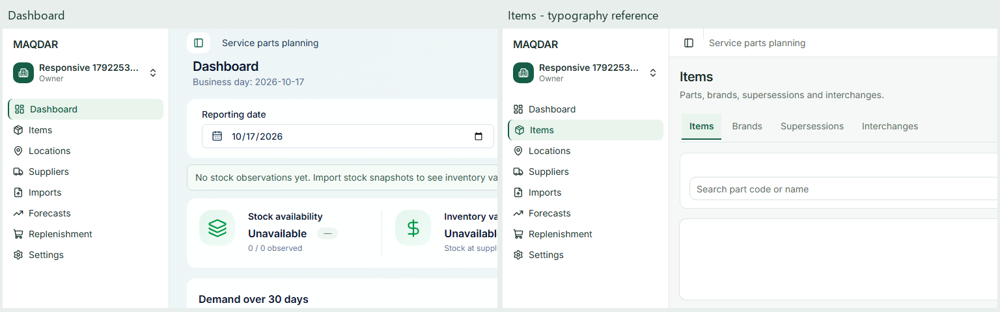

# Dashboard and Items typography consistency

The owner selected Items as the typography reference after the dashboard changed the sidebar and text scale between routes. Dashboard now uses the same shared sidebar, 20px / 28px page title and 14px / 20px subtitle, body and navigation text. Section titles use 16px / 24px; captions and chart annotations use 12px / 16px. Financial and numeric displays retain explicit separate roles.

[design.MD](../design.MD) defines the required scale and responsive exceptions. `CLAUDE.md` requires reading it for every UI change. Semantic tokens are exported from `globals.css`; dashboard prose no longer has independent breakpoint sizes. Dashboard-specific sidebar branding, icons, width, spacing and font overrides were removed in favor of the existing Items shell.

The compact laptop layout retains five KPI columns, a 222px chart and side-by-side lower panels. Table padding was reduced to accommodate the shared readable font sizes. At 1366 × 768, both lower panels finish at **y767**, inside the viewport; the KPI strip is 101px high. This supersedes the earlier laptop-density measurements. No metrics, calculations, queries or access rules changed.

## Actual browser comparison

The comparison uses unscaled crops of authenticated Dashboard and Items screenshots at the same 1920px viewport in the production app. The rendered pages have different content and panel layouts; the comparison verifies typography and the shared shell.

[Full dashboard](shared-typography-visuals/dashboard-1920.png), [full Items page](shared-typography-visuals/items-1920.png), [1366px laptop](shared-typography-visuals/dashboard-1366.png), and [Arabic 1366px](shared-typography-visuals/dashboard-arabic-1366.png).

## Verification

The responsive test checks all listed application pages at 375, 768, 1024, 1440 and 1920px. It verifies title sizes, line height, weight and font family; 14px header and navigation text; 16px navigation icons; 32px desktop rows; active-label weight; sidebar width; and desktop/mobile input sizes. Dashboard ↔ Items uses client navigation so the regression exercises the original route-switching defect. Mobile drawer typography is also checked.

The dashboard reference test retains real scoped data, eleven empty-state widths, currency selection and exact amounts, chart interaction, filters, populated laptop fit and RTL screenshots. It now checks Arabic Dashboard ↔ Items navigation against the same typography rules.

Local validation passed: production build, strict typecheck, lint, logical CSS, formatting, all 1287 unit tests and all six reference/responsive browser tests. The first visual pass identified the 10px laptop overrun; the final table spacing fixes it. Diff review found no credentials, new logging or changes to business/security logic. Coverage was not collected for this presentation change.
